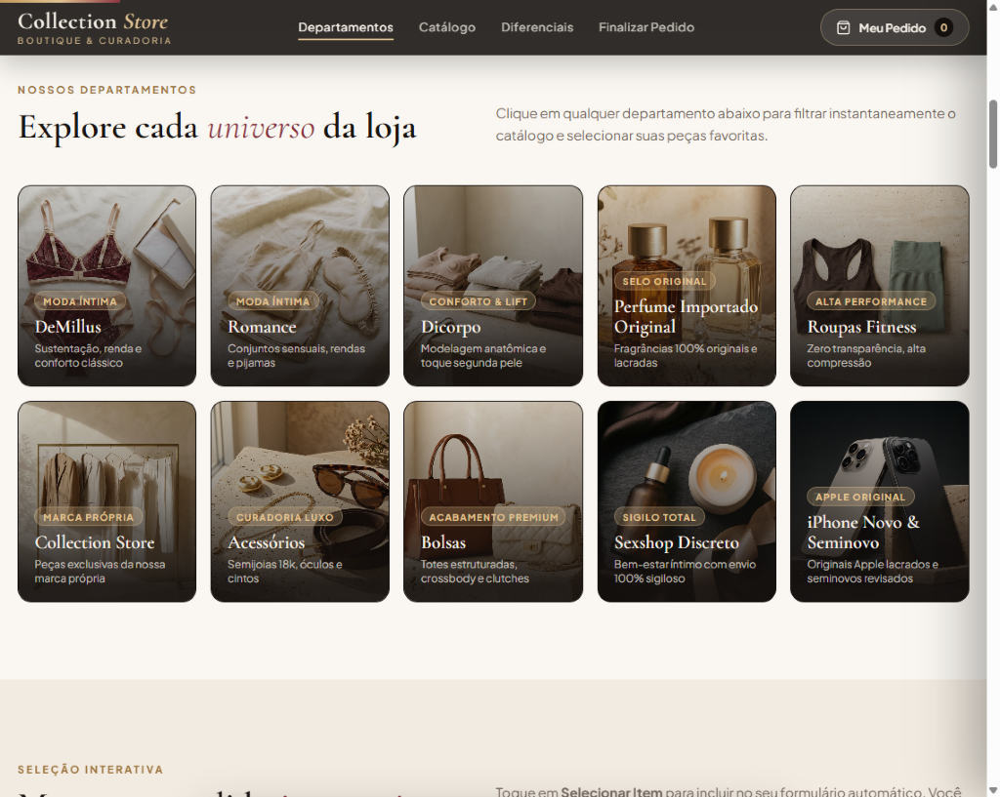
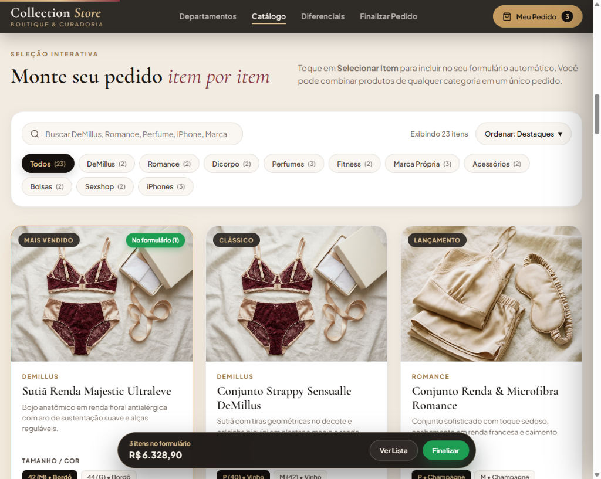
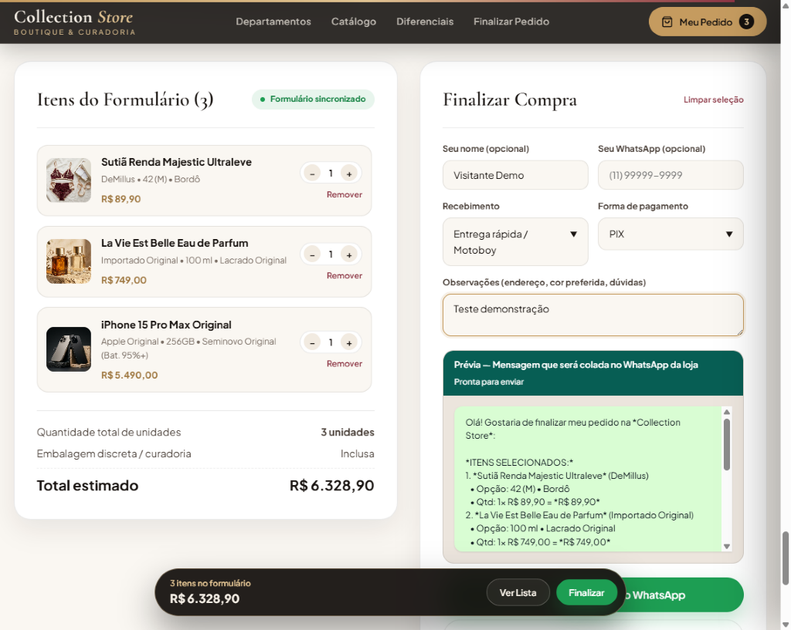
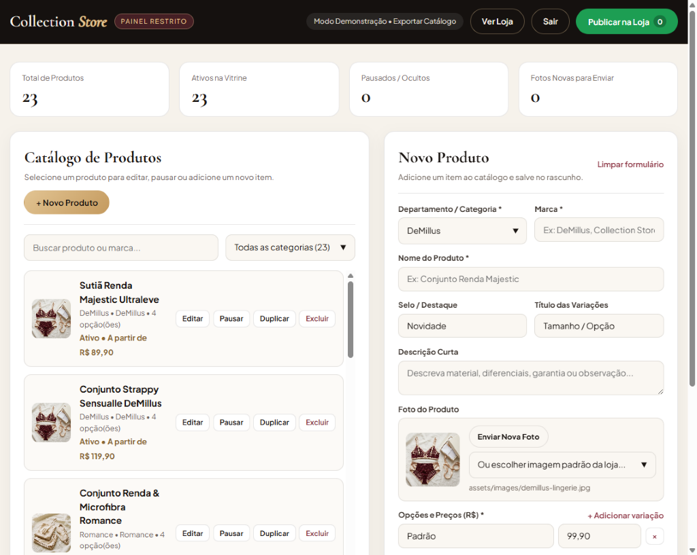
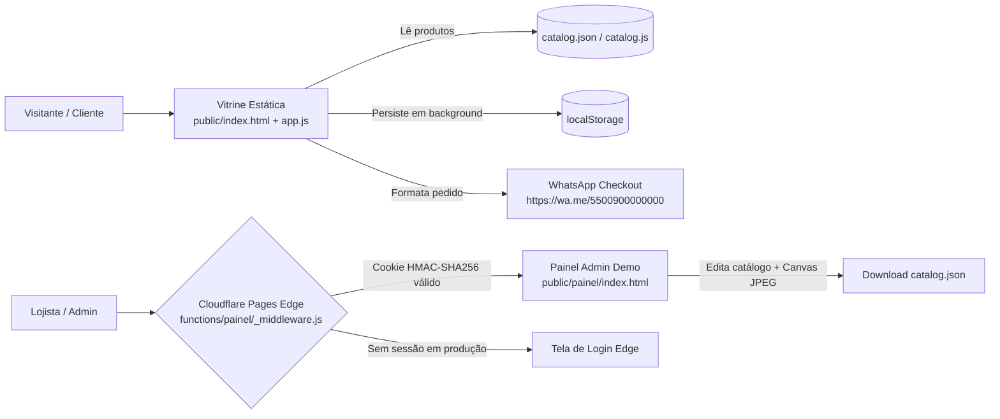

<div align="center">

<a href="#tour-animado-pela-aplicação">
  
</a>

<br /><br />


<br /><br />

<p>
  <strong>"Um problema, uma solução digital"</strong> — Vitrine boutique interativa com seleção de itens em background,<br />
  formulário inteligente conectado direto ao WhatsApp e painel administrativo em modo demonstrativo.
</p>

<p>
  <a href="#um-problema-uma-solução-digital">O Case</a> •
  <a href="#tour-animado-pela-aplicação">Tour Animado</a> •
  <a href="#visual-real-do-site">Visual do Site</a> •
  <a href="#arquitetura-e-fluxo">Arquitetura</a> •
  <a href="#como-rodar-localmente-na-sua-máquina">Como Rodar Localmente</a> •
  <a href="#personalização-rápida">Personalização</a>
</p>

</div>

---

> **Versão Pública Demonstrativa:** este repositório foi criado exclusivamente para estudo de arquitetura, portfólio e apresentação em vídeo. Todos os números de contato (`5500900000000`), dados de cliente e eventuais integrações privadas de publicação automática foram omitidos ou substituídos por valores fictícios seguros.

---

## Um Problema, Uma Solução Digital

<table>
  <tr>
    <td width="50%" valign="top">
      <h3>🔴 O Problema Original</h3>
      <ul>
        <li>Atendimento manual disperso no WhatsApp para múltiplos nichos em uma única loja (moda íntima, perfumes importados, fitness, acessórios, bolsas, sexshop discreto e iPhones).</li>
        <li>Clientes enviavam capturas de tela soltas sem especificar tamanho, cor, volume ou forma de pagamento.</li>
        <li>Atendentes perdiam tempo confirmando preços e montando orçamentos repetitivos mensagem por mensagem.</li>
        <li>Pequenos ajustes no catálogo costumavam depender de retrabalho manual no código.</li>
      </ul>
    </td>
    <td width="50%" valign="top">
      <h3>🟢 A Solução Digital</h3>
      <ul>
        <li><strong>Vitrine única e curada</strong> com visual editorial escuro e creme (<em>Obsidian + Champagne Gold</em>), organizada em 10 departamentos visuais.</li>
        <li><strong>Seleção sem fricção:</strong> ao escolher a variação (tamanho, ml ou aparelho) e tocar em <code>+ Selecionar Item</code>, o formulário de pedido é atualizado em tempo real em background.</li>
        <li><strong>Checkout direto no WhatsApp:</strong> o sistema calcula totais, persiste itens no navegador e gera uma mensagem estruturada pronta para envio em 1 clique.</li>
        <li><strong>Painel administrativo integrado:</strong> edição visual do catálogo, compressão de fotos no navegador e proteção de borda demonstrativa com cookie assinado.</li>
      </ul>
    </td>
  </tr>
</table>

---

## Tour Animado pela Aplicação

<div id="tour-animado" align="center">
  
  <br />
  <sub><i>Fluxo real capturado em execução local: Hero editorial → 10 Departamentos → Seleção Interativa → Formulário + Prévia WhatsApp → Painel Admin (Modo Demo).</i></sub>
</div>

---

## Visual Real do Site

Abaixo está uma réplica visual das principais dobras e telas funcionais do sistema capturadas em execução local:

<div align="center">
  
  <br />
  <sub><b>1. Hero Editorial & Proposta de Valor</b> — Identidade em destaque, CTAs diretos para seleção ou formulário e selos de confiança.</sub>
</div>

<br />

<table>
  <tr>
    <td width="50%" align="center" valign="top">
      
      <br /><br />
      <b>2. Exploração por Departamentos (10 linhas)</b><br />
      <sub>Filtro instantâneo por nicho: DeMillus, Romance, Dicorpo, Perfumes Importados, Roupas Fitness, Collection Store, Acessórios, Bolsas, Sexshop Discreto e iPhones.</sub>
    </td>
    <td width="50%" align="center" valign="top">
      
      <br /><br />
      <b>3. Seleção Interativa & Barra Flutuante</b><br />
      <sub>Busca em tempo real, chips de variação com alteração dinâmica de preço, controle inline de quantidade e barra flutuante acompanhando o total.</sub>
    </td>
  </tr>
  <tr>
    <td width="50%" align="center" valign="top">
      
      <br /><br />
      <b>4. Formulário Automático & Prévia WhatsApp</b><br />
      <sub>Sincronização em tempo real com <code>localStorage</code>, escolha de entrega/pagamento e pré-visualização exata da mensagem formatada antes de abrir o WhatsApp.</sub>
    </td>
    <td width="50%" align="center" valign="top">
      
      <br /><br />
      <b>5. Painel Administrativo (Modo Demo)</b><br />
      <sub>Gestão de produtos ativos/pausados, variações de preço, redimensionamento JPEG em Canvas no cliente e exportação instantânea de <code>catalog.json</code>.</sub>
    </td>
  </tr>
</table>

---

## Principais Recursos Implementados

- **Catálogo Data-Driven sem Framework Pesado:** construído com HTML5 semântico, CSS3 modular e JavaScript Vanilla (`public/js/app.js`, `public/js/catalog.js` e `public/data/catalog.json`), garantindo carregamento imediato sem etapa obrigatória de build ou `node_modules`.
- **Estado Persistente em Background:** os itens selecionados (`collection_store_order_items_v1`) e os dados preenchidos pelo visitante (`collection_store_customer_v1`) ficam salvos no `localStorage`, permitindo navegar entre departamentos sem perder o pedido.
- **Variações com Preço Dinâmico:** cada card suporta múltiplas opções (ex.: tamanhos `P`, `M`, `G`, frascos `50 ml` / `100 ml`, armazenamentos `128GB` / `256GB` novos ou seminovos) atualizando o valor na hora.
- **Painel Admin com Processamento Local de Imagem:** em `public/painel/admin.js`, imagens selecionadas pelo lojista são convertidas e redimensionadas no próprio navegador via HTML5 Canvas (`maxDim = 1200`, JPEG qualidade `0.86`) e o catálogo editado pode ser exportado como `catalog.json`.
- **Middleware de Autenticação na Borda (Cloudflare Pages):** em `functions/painel/_middleware.js` + `functions/_shared/auth.js` + `public/_routes.json`, o acesso a `/painel` e `/painel/*` demonstra autenticação baseada em formulário HTML, comparação em tempo constante (`timingSafeEqual`) e cookie `HttpOnly` assinado via **HMAC-SHA256** (`TTL` de 12 horas).

---

## Arquitetura e Fluxo



> **Comportamento em servidor local vs. Edge:** ao rodar apenas a pasta `public/` em um servidor estático local (`python`, `npx serve` ou VS Code Live Server), o `/painel/` abre diretamente no **Modo Demonstração** para exploração imediata sem necessidade de configurar variáveis de ambiente.

---

## Como Rodar Localmente na Sua Máquina

Você não precisa instalar dependências pesadas, banco de dados ou ferramentas de build. Escolha **uma** das opções abaixo:

### 1. Baixe ou clone o repositório

```bash
git clone https://github.com/LRGabrieldev/collection-store-demo.git
cd collection-store-demo
```

> **Dica:** evite abrir o arquivo `public/index.html` dando duplo clique (`file://...`), pois alguns navegadores bloqueiam leituras relativas de arquivos e rotas `/painel/`. Sempre suba um servidor HTTP simples apontando para a pasta `public/`.

---

### 2. Escolha uma forma de iniciar o servidor local

<details open>
<summary><strong>Opção A — Python (recomendada e mais rápida)</strong></summary>

```bash
# Windows / padrão
python -m http.server 8787 --bind 127.0.0.1 --directory public
```

Se estiver no **Windows** com Python Launcher (`py`) ou no **Linux/macOS** com `python3`:

```bash
# Windows Launcher
py -m http.server 8787 --bind 127.0.0.1 --directory public

# Linux / macOS
python3 -m http.server 8787 --bind 127.0.0.1 --directory public
```

</details>

<details>
<summary><strong>Opção B — Node.js (npx serve)</strong></summary>

```bash
npx serve public -l 8787
```

</details>

<details>
<summary><strong>Opção C — VS Code (Live Server)</strong></summary>

1. Abra a pasta `collection-store-demo` no VS Code.
2. Instale a extensão **Live Server** (`ritwickdey.LiveServer`).
3. Em configurações (`.vscode/settings.json`), defina `"liveServer.settings.root": "/public"` ou abra diretamente a pasta `public/` e clique em **Go Live**.

</details>

<details>
<summary><strong>Opção D — Opcional: Simular o login na borda localmente (Cloudflare Wrangler)</strong></summary>

Se quiser testar também o comportamento da Cloud Function (`functions/painel/_middleware.js`) bloqueando `/painel/*` com login:

1. Crie um arquivo `.dev.vars` na raiz do projeto (ele já está ignorado pelo `.gitignore` e **nunca** deve ser enviado ao Git):

   ```ini
   ADMIN_USER=admin
   ADMIN_PASS=escolha-uma-senha-local
   SESSION_SECRET=chave-aleatoria-local-para-hmac
   ```

2. Execute com Cloudflare Wrangler:

   ```bash
   npx wrangler pages dev public
   ```

</details>

---

### 3. Acesse no navegador

- **Vitrine da Loja:** [`http://127.0.0.1:8787/`](http://127.0.0.1:8787/)
- **Painel Administrativo (Modo Demo):** [`http://127.0.0.1:8787/painel/`](http://127.0.0.1:8787/painel/)

---

## Personalização Rápida

### Alterar WhatsApp de teste, nome ou textos institucionais

Edite o arquivo [`public/js/config.js`](public/js/config.js):

```javascript
window.STORE_CONFIG = {
  storeName: 'Collection Store',
  tagline: 'Moda Íntima, Marca Própria, Perfumaria, Acessórios & Apple',
  // Substitua pelo WhatsApp de teste desejado (DDI + DDD + Número, apenas dígitos)
  whatsappNumber: '5500900000000',
  instagramHandle: '@collectionstore',
  cityLabel: 'Envio para todo o Brasil • Retirada local sob consulta',
  discreetShippingNote: 'Embalagens 100% discretas e sem identificação externa para pedidos íntimos e sexshop.',
  currency: 'BRL'
};
```

### Atualizar produtos pelo Painel Demo

1. Acesse `/painel/` no navegador.
2. Adicione, edite ou pause qualquer produto ou variação de preço.
3. Clique em **Exportar JSON** (ou no modal de exportação do modo demonstração) para baixar o novo `catalog.json`.
4. Substitua [`public/data/catalog.json`](public/data/catalog.json) pelo arquivo baixado e recarregue a vitrine.

---

## Estrutura do Repositório

```text
collection-store-demo/
├── .gitignore
├── README.md
├── docs/                              # Mídias visuais e animações do README
│   ├── hero-banner.svg                # Banner SVG animado (SMIL)
│   ├── showcase-demo.gif              # Tour animado pelas 5 telas
│   ├── preview-hero.png
│   ├── preview-departamentos.png
│   ├── preview-catalogo.png
│   ├── preview-checkout.png
│   └── preview-painel.png
├── functions/                         # Cloudflare Pages Functions (Edge Auth demo)
│   ├── _shared/auth.js                # Sessão HMAC-SHA256 e HTML de login
│   └── painel/_middleware.js          # Proteção da rota /painel/*
└── public/                            # Raiz estática servida no navegador
    ├── _routes.json                   # Roteamento Edge restrito a /painel*
    ├── index.html                     # Vitrine principal
    ├── robots.txt
    ├── assets/images/                 # Imagens curadas dos 10 departamentos + Hero
    ├── css/styles.css                 # Design system (Obsidian & Champagne Gold)
    ├── data/catalog.json              # Catálogo estruturado em JSON (23 itens)
    ├── js/
    │   ├── config.js                  # Configurações e WhatsApp demonstrativo
    │   ├── catalog.js                 # Fallback offline / inicialização do catálogo
    │   └── app.js                     # Filtros, variações, localStorage e WhatsApp
    └── painel/
        ├── index.html                 # Interface do Painel Administrativo
        ├── admin.css                  # Estilos do Painel
        └── admin.js                   # CRUD em rascunho, Canvas JPEG e Export JSON
```

---

## Segurança e Privacidade

- **Nenhuma credencial incluída:** não há chaves de API, segredos de sessão, tokens de serviço ou e-mails pessoais no código ou no histórico do repositório.
- **Contato fictício:** todas as chamadas de checkout neste showcase usam o número demonstrativo `5500900000000`.
- **Sem publicação remota no showcase:** o painel roda em modo demonstração puramente local com download de `catalog.json`, sem integração com repositórios ou serviços externos privados.

---

<div align="center">
  <sub>Projeto demonstrativo desenvolvido para o case <strong>"Um problema, uma solução digital"</strong>.</sub>
</div>
